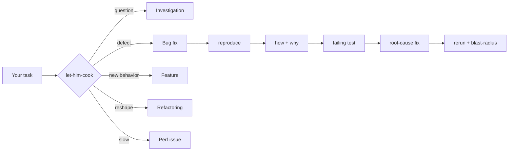

# let him cook

**Agent skills for Claude Code, Codex, and Cursor.** [Lauren Tan](https://github.com/poteto)'s [pstack](https://github.com/cursor/plugins/tree/main/pstack/skills), rebuilt so one agent does the work in one context, on the plan you already have.

You describe the task. `let-him-cook` picks the recipe, runs the right skills in order, and proves the result before calling it done.

```
/let-him-cook the checkout button double-charges on slow networks
```



## Why this exists

I don't have unlimited tokens.

[pstack](https://github.com/cursor/plugins/tree/main/pstack/skills) is great, but it fans work out to subagents, and each one re-reads the same context, so the cost multiplies fast on a single plan. This keeps the skills and has one agent do every step itself, with subagents only when you ask.

## The house rules

1. **One agent does the cooking.** Every skill runs inline. Subagents only show up when you ask for them, so a task never quietly multiplies its token bill.
2. **Proof beats opinion.** A fix starts from a repro, a feature ends on the real surface, and a review finding only counts when a run proves it.
3. **No vendor lock.** No model slugs, no setup step. [HARNESSES.md](HARNESSES.md) maps every tool, model role, and path to Claude Code, Codex, and Cursor.

## Install

Clone into your harness's skill folder. Use an empty folder, or back up the one you have.

| Harness | Command |
| --- | --- |
| Claude Code | `git clone https://github.com/KyrosHendrix/skills ~/.claude/skills` |
| Codex | `git clone https://github.com/KyrosHendrix/skills ~/.agents/skills` |
| Cursor | `git clone https://github.com/KyrosHendrix/skills ~/.cursor/skills` |

Want just one skill? Copy its folder, plus `HARNESSES.md` and `principles/`, which most skills link to.

Most skills run only when you type their slash command, like `/how` or `/why`. You don't need to remember them. Start with `/let-him-cook`, or let it load on its own when a coding task begins.

## The menu

### Start here

| Skill | What it does |
| --- | --- |
| [let-him-cook](let-him-cook/SKILL.md) | Matches the task to a recipe and runs the skills below in order. |

### Understand it

| Skill | What it does |
| --- | --- |
| [how](how/SKILL.md) | Explains how code works, and where new code should live. |
| [why](why/SKILL.md) | Digs up the reasons behind code, decisions, and regressions from every source it can reach. |
| [teach](teach/SKILL.md) | Runs `how` and `why`, then explains it all plainly. |
| [recall](recall/SKILL.md) | Rebuilds your recent context from chat history and shared records. |
| [ketchup](ketchup/SKILL.md) | Catches you up on what changed since your last message. |
| [ketchup-video](ketchup-video/SKILL.md) | Same, as a short subtitled slide video. |
| [bro](bro/SKILL.md) | Restates the last message with no jargon. |
| [in-your-own-words](in-your-own-words/SKILL.md) | Restates your goal to check the agent actually gets it. |

### Design it

| Skill | What it does |
| --- | --- |
| [architect](architect/SKILL.md) | Sketches types, signatures, and modules before any code, then builds against the sketch. |
| [arena](arena/SKILL.md) | Writes competing drafts, picks a base, and grafts in the best parts of the rest. |
| [figure-it-out](figure-it-out/SKILL.md) | Designs a playbook for big migrations and multi-part changes. |
| [sharpen](sharpen/SKILL.md) | Makes a task deeper, not bigger, and rewrites the prompt. |
| [principles](principles/SKILL.md) | 24 engineering principles, each with the moment it applies. |

### Prove it

| Skill | What it does |
| --- | --- |
| [tdd](tdd/SKILL.md) | Writes the failing test first when the target is cheap and obvious. |
| [blast-radius](blast-radius/SKILL.md) | Finds what a change could break outside the diff, and runs code to prove it's safe. |
| [benchmark-checklist](benchmark-checklist/SKILL.md) | Vets a perf number before anyone trusts it. |
| [create-verification-skill](create-verification-skill/SKILL.md) | Generates a project skill that drives your app like a user. |
| [maintain-verification-skill](maintain-verification-skill/SKILL.md) | Keeps that skill honest as the app changes. |
| [create-formal-verification-skill](create-formal-verification-skill/SKILL.md) | Generates formal verification for the code where bugs cost the most. |
| [maintain-formal-verification-skill](maintain-formal-verification-skill/SKILL.md) | Brings the formal specs back in line after code changes. |
| [statechart](statechart/SKILL.md) | Checks a TLA+ model and draws it as a Mermaid statechart. |
| [interrogate](interrogate/SKILL.md) | Attacks a change, keeping only the findings a run proves. |

### Ship it clean

| Skill | What it does |
| --- | --- |
| [pr](pr/SKILL.md) | Writes the PR title and body. |
| [no-comments](no-comments/SKILL.md) | Cuts comments that don't earn their place. |
| [unslop](unslop/SKILL.md) | Cuts AI tells from any writing. |
| [technical-writing](technical-writing/SKILL.md) | Holds docs, READMEs, and commit messages to a real style standard. |
| [typescript-best-practices](typescript-best-practices/SKILL.md) | Keeps `.ts` and `.tsx` code typed properly. |
| [correct](correct/SKILL.md) | Finds mistakes agents keep repeating and makes them impossible. |
| [reflect](reflect/SKILL.md) | Turns lessons from a session into edits to the skills. |
| [show-me-your-work](show-me-your-work/SKILL.md) | Keeps a decision log for long or unattended runs. |

### Only when you ask

| Skill | What it does |
| --- | --- |
| [swarm](swarm/SKILL.md) | Fans out parallel workers and returns one report. The one skill that always spawns subagents, so it never runs on its own. |

## Where it came from

Every skill except `let-him-cook` and `pr` is adapted from [pstack](https://github.com/cursor/plugins/tree/main/pstack/skills) by [Lauren Tan](https://github.com/poteto). [UPSTREAM.md](UPSTREAM.md) records every change and how [pstack](https://github.com/cursor/plugins/tree/main/pstack/skills) updates get merged. The `upstream` branch holds [pstack](https://github.com/cursor/plugins/tree/main/pstack/skills) exactly as published.

- `let-him-cook` is new here, built from the ideas in [pstack](https://github.com/cursor/plugins/tree/main/pstack/skills)'s `poteto-mode` playbooks, minus the delegation.
- `pr` combines [Matt Pocock](https://github.com/mattpocock)'s [pr](https://github.com/mattpocock/skills/tree/main/skills/engineering/pr) with the title rules from [Theo](https://github.com/t3dotgg)'s [file-pr](https://github.com/t3dotgg/tstack/tree/main/skills/file-pr).
- Left out from [pstack](https://github.com/cursor/plugins/tree/main/pstack/skills): `automate-me`, `make-bot-ui`, `poteto-help`, `poteto-mode`, and `setup-pstack`. [UPSTREAM.md](UPSTREAM.md) says why.

## License

MIT. The root [LICENSE](LICENSE) covers this repo's own work. [THIRD_PARTY_NOTICES.md](THIRD_PARTY_NOTICES.md) holds the notices for [Lauren Tan](https://github.com/poteto), [Matt Pocock](https://github.com/mattpocock), and [Theo Browne](https://github.com/t3dotgg).
